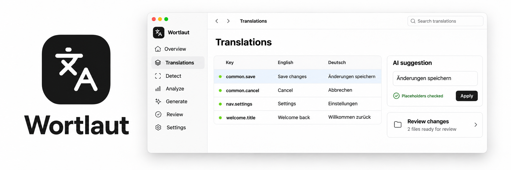

<p align="center">
  
</p>

# Wortlaut

**Make your application's translations visible and manageable.**

Find the gaps in your code. Manage every language. Review the changes.

[](https://github.com/pixel-brewery/wortlaut/actions/workflows/ci.yml)
[](https://github.com/pixel-brewery/wortlaut/actions/workflows/release.yml)
[](LICENSE)

[Install](#install) · [Workflow](#from-hard-coded-text-to-reviewed-translations) · [Capabilities](#what-it-does) · [CLI](#command-line) · [Build from source](#build-from-source) · [Documentation](docs/README.md) · [Contributing](CONTRIBUTING.md)

## Why Wortlaut exists

Translation work is easy to lose sight of: a hard-coded label in a component, a key
missing from one language, an outdated value in another. A collection of catalog
files does not show the whole picture. Wortlaut brings the source code and the
language catalogs into one workflow, so you can see what needs attention and
manage the work through to a reviewed change.

It began as Translator, a command-line tool later developed as Localizator. The
earliest retained project brief dates to
[October 2021](https://github.com/RueDeRennes/mosaik/commit/cec54e0b467fb707d7e0cd66118828475299c2e4):
detect translatable source text, extract it into language resources and merge new
findings with existing translations. The recent desktop redesign gives that
established workflow a visual home.

- **See where the work is.** Connect source findings with translation keys and
  expose missing or inconsistent translations across languages.
- **Manage the whole workflow.** Detect, analyze, edit, translate, convert and sort
  through one engine, with a visual application and command-line integrations.
- **Keep changes reviewable.** Inspect proposed file changes before applying them
  to the repository.

## From hard-coded text to reviewed translations

The desktop application makes project coverage, source findings and language catalogs
visible together. The CLI, Nx executor, ESLint rules and MCP server expose the same
engine, so interactive work and automated checks follow the same rules.

| Step                          | Work in Wortlaut                                                                                                                                            |
| ----------------------------- | ----------------------------------------------------------------------------------------------------------------------------------------------------------- |
| **Open the project**          | Choose a repository, find its catalogs and select the framework preset, base locale and target languages. Existing configuration stays the source of truth. |
| **Find what needs attention** | Detect hard-coded strings and analyze catalogs for missing translations, unused keys, duplicates and placeholder mistakes.                                  |
| **Translate and edit**        | Work with keys and values, request an AI suggestion or translate a selected set of keys with your chosen provider.                                          |
| **Review and write**          | Inspect the files in a change set, then approve or discard it. Applying rechecks the files and refuses a change if they have changed in the meantime.       |

Catalogs and project configuration stay in your repository. Workspaces, pending change sets
and run history live in your user profile; `WORTLAUT_HOME` selects another location. The desktop
app protects API keys with the operating system's keychain. Local assistant CLIs keep their own login.

## Install

Until the first public release is published, [build from source](#build-from-source).
The release pipeline prepares these installers for [Releases](https://github.com/pixel-brewery/wortlaut/releases):

| Platform              | Release asset                         |
| --------------------- | ------------------------------------- |
| macOS (Apple Silicon) | `Wortlaut-darwin-arm64-<version>.dmg` |
| Windows (x64)         | `Wortlaut-win32-x64-<version>.exe`    |

Each release includes `SHA256SUMS.txt`. macOS bundles use ad-hoc sealing without notarization;
Windows installers are unsigned. See [Releasing](docs/release.md) for the distribution policy.

The CLI is packaged as `@pixel-brewery/wortlaut-app` on GitHub Packages. It supplies both
`wortlaut` and the compatible `localizator` command, plus `run()` for programmatic integrations.
Package access requires an authenticated `@pixel-brewery` registry configuration, as in
the repository's [.yarnrc.yml](.yarnrc.yml).

### What you need alongside it

- A repository containing application source files or translation catalogs
- An AI provider for translation features: an OpenAI or Google API key, or an installed
  Claude Code, Codex or OpenCode CLI with its own login
- Node.js 24.15 or newer for the command line and source builds

Detection, analysis, sorting and format conversion work without an AI provider.

## What it does

- **Detect source text.** Find hard-coded strings with Angular, React, Vue, Lit and Stencil
  presets. Propose source replacements and base-locale catalog entries together.
- **Analyze catalogs.** Find translation gaps, unused keys, duplicate values and placeholder
  problems. Configure rule severities and use findings as a CI gate.
- **Edit translations.** Browse namespaces, search keys and values, edit a target locale and
  request a checked AI suggestion for a selected key.
- **Translate with AI.** Use API providers or local assistants through Synapse. Narrow a run
  by locale, namespace, keys or limit; validate model output for shape, keys and placeholders.
- **Convert and sort.** Read JSON, RESX and PO catalogs, convert between them, generate
  TypeScript output and keep keys in a consistent order.
- **Review changes.** Inspect proposed file changes, approve or discard them and catch
  conflicts before writing. The app, CLI and MCP server use the same change-set engine.
- **Extend the rules.** Load declarative rule packs from GitHub, npm or a local folder.
  Packs contain no executable code and are pinned by commit and content hash.
- **Connect assistants.** Expose the engine over MCP with read, propose and write permission
  levels. Claude and Codex plugins carry the connection and workflow instructions.

## Command line

```bash
wortlaut detect
wortlaut analyze
wortlaut generate
wortlaut transform
wortlaut sort
wortlaut init
wortlaut config
wortlaut catalog
wortlaut changes
wortlaut rules
wortlaut ai status
wortlaut mcp
```

Run `wortlaut <command> --help` for its options. Commands apply their change sets by default.
`--dry-run` only reports changes, `--review` leaves them pending, and `--json` prints one
document for scripts and CI:

```bash
wortlaut sort --resource-root i18n --review
wortlaut changes list
wortlaut changes show <id>
wortlaut changes apply <id>
wortlaut changes discard <id>
```

Applying rechecks every file and writes all of them or none. If a file changed after the
proposal was built, the apply fails and names that file.

Settings resolve from `nx.json`, `project.json`, `wortlaut.config.json` and command arguments.
`wortlaut config list` shows each value with its source; `wortlaut config set <key> <value>`
proposes a change to the owning file. The old `localizator.config.json`,
`localizator.lock.json` and Nx executor names remain supported.

`wortlaut rules check <source>` inspects a rule pack; `wortlaut rules add <source>` pins it
in `wortlaut.lock.json`. Use `list`, `update`, `enable`, `disable` and
`severity <rule> <error|warning|off>` to manage it. A pack that no longer matches its pin is
refused. Once a repository has a lock file or configured severities, `analyze` exits with 1
for an error finding or a refused pack. In `wortlaut.config.json` or an Nx target's options,
set `actions.analyze.expectedLocales` to a list such as `["en", "de"]` to require at least
one translation key for each locale across the configured catalog roots. A missing or
empty expected locale fails analysis regardless of rule severities. JSON catalogs with
duplicate member names also fail before any rules run.

For a rule pack in a private GitHub repository, use a token with read access to that
repository's contents. Store it under **Settings → Application → GitHub rule packs**
in the desktop app, or set `WORTLAUT_GITHUB_TOKEN` for the CLI or CI. Wortlaut sends
the token only to GitHub's official API.

`wortlaut mcp` starts the MCP server over stdio. It is read only until the user selects a
different level in the app under MCP and plugins. Assistant proposals wait in Review.
See the [MCP package](libs/backend/mcp/README.md) for tools and permission levels.

## Architecture

Thin application roots in `apps/cli`, `apps/desktop` and `apps/frontend/app` compose one
framework-neutral engine. The Angular renderer calls Electron through the typed,
Zod-validated contracts in `libs/contracts`; backend libraries own catalog and file operations.
Mosaik supplies the controls and Soho theme, and Synapse connects local assistant CLIs.

| Package                                | Source                      | Responsibility                                                        |
| -------------------------------------- | --------------------------- | --------------------------------------------------------------------- |
| `@pixel-brewery/wortlaut-core`         | `libs/backend/core`         | Detectors, presets, readers, analyzer rules, transformers and sorting |
| `@pixel-brewery/wortlaut-ai`           | `libs/backend/ai`           | Translation strategies, chunking and model-output validation          |
| `@pixel-brewery/wortlaut-contracts`    | `libs/contracts`            | Schemas and types for runs, change sets and settings                  |
| `@pixel-brewery/wortlaut-engine`       | `libs/backend/engine`       | Project use cases, configuration, change sets, review and run history |
| `@pixel-brewery/wortlaut-mcp`          | `libs/backend/mcp`          | MCP tools, permission levels and assistant plugins                    |
| `@pixel-brewery/wortlaut-app`          | `apps/cli`                  | The `wortlaut` command and programmatic `run()` entry point           |
| `@pixel-brewery/wortlaut-nx-tasks`     | `libs/backend/nx-tasks`     | The Nx executor over `run()`                                          |
| `@pixel-brewery/wortlaut-eslint-rules` | `libs/backend/eslint-rules` | ESLint rules over the analyzer rules                                  |

Frontend infrastructure lives in `libs/frontend/{core,ui,shell}`, with one feature library
per product area under `libs/frontend/features`. The Nx executor and the ESLint rules sit on
the same backend packages; [surface guidance](.agents/skills/wortlaut-architect/references/surfaces.md) records
the integration and compatibility contracts.

Start with the [documentation index](docs/README.md), [feature map](docs/architecture/feature-map.md)
and [Wortlaut Architect](.agents/skills/wortlaut-architect/SKILL.md). The feature map also
describes planned behavior; cloud execution is a later surface.

## Build from source

> [!IMPORTANT]
> Wortlaut installs the `@pixel-brewery` packages from GitHub Packages.
> Export a GitHub token with `read:packages` as `GITHUB_TOKEN` before installing dependencies.

Requires Node.js 24.15 or newer, Corepack and Python 3. Yarn 4.18.1 is pinned in `package.json`.

```bash
corepack enable
export GITHUB_TOKEN=YOUR_GITHUB_PAT
yarn install --immutable
yarn start
```

`yarn dev`, `yarn start` and `yarn start:unpackaged` build the renderer and desktop bundles, then launch Electron.
`yarn start:built` reuses an existing build.

Run the complete local gate from a graphical desktop session.

```bash
yarn verify          # code checks, clean package consumers, built and packaged desktop smoke
yarn verify:code     # repository checks, formatting, lint, types, tests and builds
yarn e2e             # build and exercise the desktop app
yarn package:smoke   # package the app, check its contents and launch it for verification
yarn make            # create native distribution artifacts in out/
```

To build and run the CLI from this checkout:

```bash
yarn nx run wortlaut-app:build
node apps/cli/dist/bin/wortlaut.js --help
```

Full contributor guidance is in [CONTRIBUTING.md](CONTRIBUTING.md); [AGENTS.md](AGENTS.md)
holds the repository rules.

## Releases

Releases belong to the owner. Changes beyond documentation on `main` request a release:
Nx prepares one version, changelog, commit and `v<version>` tag, and native builds verify
that same candidate. After verification, the pipeline publishes the eight packages and
the macOS and Windows installers with their checksums. Documentation-only changes skip
tests, builds and automatic release; explicit manual releases still run the full checks.

See [Releasing](docs/release.md) for activation requirements, rehearsal, manual release
commands and the publication sequence.

## Contributing and security

Use the [issue templates](https://github.com/pixel-brewery/wortlaut/issues/new/choose) for
reproducible bugs and feature ideas. Start with [CONTRIBUTING.md](CONTRIBUTING.md) and the
[Code of Conduct](CODE_OF_CONDUCT.md). Report vulnerabilities privately through
[GitHub Security Advisories](https://github.com/pixel-brewery/wortlaut/security/advisories/new);
the reporting scope is in [SECURITY.md](SECURITY.md).

Wortlaut grew out of `tools/localizator` in [Mosaik](https://github.com/pixel-brewery/mosaik),
preserving its history and existing consumer names.

## License

[MIT](LICENSE). Wortlaut uses Electron, Angular, Mosaik and Synapse under their respective licenses.
